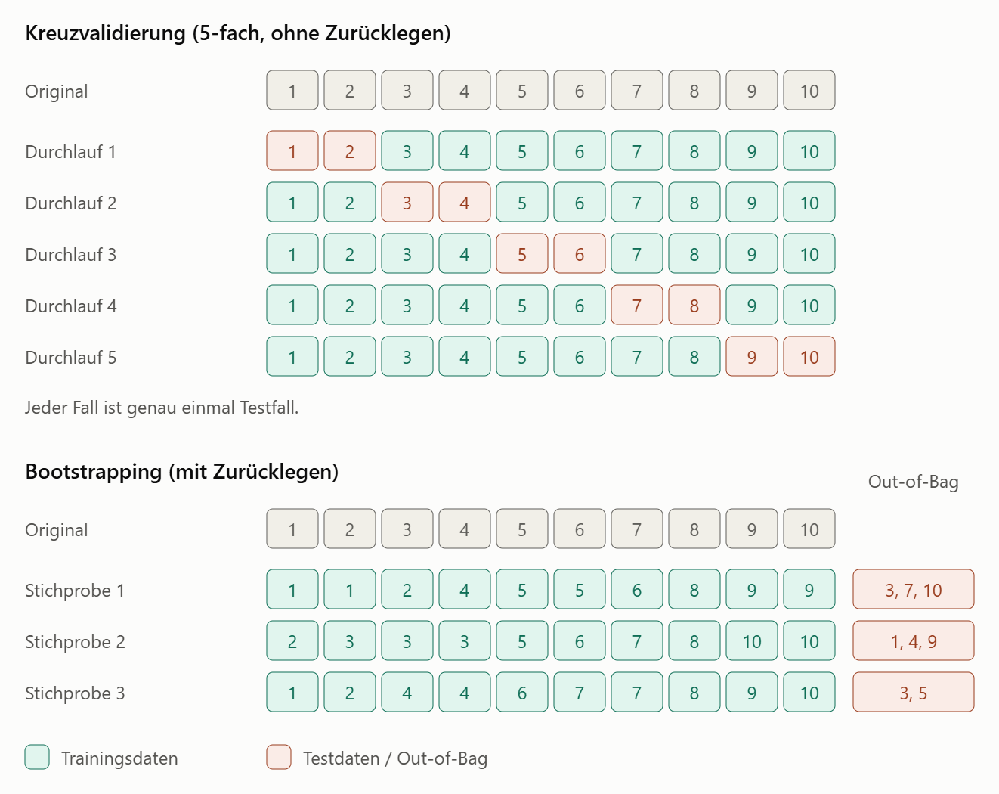

# Besprechung der Analysepipeline + Modellentwicklung
*18.11.2026*

**Ziele:**
1. Modellentwicklung in Python verstehen
2. Evaluation von Modellen
3. Kritische Bewertung von Modellen


## Start: Recap letzte Stunde und Online-Übung

Im letzten Seminar sind wir bis zur (3) Datenaufbereitung gekommen:


### 1. Fragestellung
Können wir mit $SpO_2$ Daten Vorhersagen zu Hypoxie treffen?

### 2. Daten
Wie benutzen $SpO_2$ Daten aus der MIMIC-IV Datenbank (Patienten der Intensivstation und Notaufnahme).

### 3. Aufbereitung
Datenaufbereitung für den finalen Datensatz zur Analyse [Lösung der Datenaufbereitung](02-5_Datenaufbereitung_SpO2_Loesung.ipynb).

## Besprechung der Lösungen

### Lösung der Datenaufbereitung

- Fragen?
- [Lösungsnotebook](02-5_Datenaufbereitung_SpO2_Loesung.ipynb)

### 4. Modell + 5. Evaluation
Einfache Modellentwicklung eines Random Forests:

- Fragen?
- [Lösungsnotebook](02-6_Modellentwicklung_SpO2_Loesung.ipynb) Teil 1

> Ziel 1 erfüllt.

**Teil 2: Bewertung des Modells**

Obwohl es ein deutliches Overfitting gibt, ist der Random Forest eine gute Wahl für diese Analyse:

- Durch das Schiebefenster wird aus der Zeitreihe eine normale Tabelle.
- Der Random Forest erkennt nichtlineare Muster wie Trends oder Ausreißer, ohne dass man Merkmale selbst konstruieren muss.
- Er braucht keine Standardisierung und ist durch das Mitteln vieler Bäume robust.
- Er sagt immer Mittelwerte aus echten Trainingswerten vorher. Deshalb gibt er nie unmögliche Werte wie 103 % aus.
- Bei 13.000 Zeilen ist er in Sekunden trainiert. Für ein neuronales Netz wäre der Datensatz zu klein.

Dennoch schneidet er auf diesem Datensatz kaum besser als triviale Regeln ab:

|Befund|Zahlen|
|---|---|
|Random Forest mit Standardeinstellungen|MAE 1,47, R² 0,28|
|Regel „Mittelwert der letzten 5 Werte“|MAE 1,41, R² 0,33, also **besser**|
|Random Forest mit `min_samples_leaf=20`|schlägt die Baseline, aber knapp|
|Erkennung von Entsättigungen < 92 %|Random Forest 17 %, einfache Regeln ca. 35 %|

Der Grund: $SpO_2$-Schwankungen sind größtenteils Messrauschen. Die Abweichungen bewegen sich im Bereich der Pulsoxymeter-Genauigkeit von etwa ±2 %. Daraus schließt sich:

- Man braucht immer eine Baseline.
- Standardeinstellungen führen bei verrauschten Daten zu Overfitting.
- Ein besserer MAE bedeutet nicht automatisch einen besseren klinischen Nutzen.
- Die Grenze liegt in den Daten, nicht im Algorithmus.

**Teil 3: Evaluation des Modells**

Evaluation: Das "Wie gut" ist das Modell <=> Interpretation: "Was" hat das Modell gelernt, wie wird es angewendet und ist es klinisch plausibel

**Bootstrap vs. Cross-Validation**
Beides sind sogenannte *resampling* Methoden. Sie werden verwendet, um stabile Gütemaße zu berechnen.

- **Bootstrapping** zieht Stichproben mit Zurücklegen (und erzeugt dabei üblicherweise neue „Ersatzdatensätze“ mit derselben Anzahl an Fällen wie der ursprüngliche Datensatz). Da mit Zurücklegen gezogen wird, kann ein Bootstrap-Datensatz denselben ursprünglichen Fall mehrfach enthalten, während andere ursprüngliche Fälle darin gar nicht vorkommen. Wird vor allem eingesetzt, um empirische Verteilungsfunktionen für ein breites Spektrum statistischer Kenngrößen zu bestimmen. „Breit“ heißt hier etwa: von der Streuung des Mittelwerts bis hin zur Streuung der Einzelmodelle in Bagging-Ensembles.
- **Cross-Validation** zieht Stichproben ohne Zurücklegen und erzeugt daher Ersatzdatensätze, die kleiner sind als der ursprüngliche Datensatz. Diese Datensätze werden systematisch so gebildet, dass nach einer vorab festgelegten Anzahl *k* von Ersatzdatensätzen jeder der *n* ursprünglichen Fälle genau einmal ausgelassen wurde. Man spricht dann von *k*-facher Kreuzvalidierung (*k*-fold cross validation) oder von Leave-x-out-Kreuzvalidierung mit *x = n/k*. Bei der Leave-one-out-Kreuzvalidierung wird beispielsweise pro Ersatzdatensatz genau ein Fall weggelassen, also *x = 1* (bzw. *k = n*). Es dient in erster Linie dazu, die (Generalisierungs-)Leistung eines Modells zu messen.



| Merkmal | Cross-Validation | Bootstrapping |
| :--- | :--- | :--- |
| **Stichprobenziehung** | Ohne Zurücklegen | Mit Zurücklegen |
| **Bias** | Gering (nahezu unverzerrt) | Leichte Verzerrung des Fehlers nach oben / Accuracy nach unten |
| **Variance** | Mittel | Gering |
| **Hauptanwendung** | Schätzung der Modellleistung & Modellauswahl | Quantifizierung von Unsicherheit (Standardfehler/Konfidenzintervalle) & Ensemble-Lernen |
| **Test Set** | Zurückgehaltener Fold (~1/$k$) | Out-of-bag-Fälle (~37%) |

**Begründung für den Bias**: Eine Bootstrap-Stichprobe enthält zwar *n* Fälle, wegen des Ziehens mit Zurücklegen aber nur etwa 63,2 % verschiedene Fälle. Die übrigen sind Duplikate und liefern kaum neue Information. Ein Bootstrap-Modell lernt also aus deutlich weniger Information als das finale Modell, das auf allen Daten trainiert wird. Weniger Daten bedeuten meist ein schwächeres Modell, und so wird der Fehler des finalen Modells überschätzt. Wie stark, hängt von der Lernkurve ab: Bei kleinen Datensätzen und flexiblen Modellen ist der Effekt groß, bei gesättigter Lernkurve vernachlässigbar. Die Kreuzvalidierung hat dasselbe Problem, aber schwächer. Bei 10-facher Kreuzvalidierung trainiert jedes Modell auf 90 % der Daten statt auf etwa 63 %, deshalb gilt sie als nahezu unverzerrt.

**Bland-Altman-Plot**
Vergleich von "alt vs. neu". Der Bias zeigt eine systematische Abweichung an, die limits of agreement (Bias ± 1,96 × SD) zeigen den Bereich, in dem 95% aller Abweichungen liegen. Hier zeigen sich - wie in unserem Beispiel - Über- oder Unterschätzungen bei geringer Datenlage. Diese Werte können bei unzureichender Evaluation (z.B. reine Zahlenbetrachtung von klassischen Kenngrößen) untergehen.

**Kenngröße pro Patient -> für wen funktioniert das Modell?**
Kenngrößen zweier Verfahren lassen sich gegeneinander plotten, z.B. MAE Baseline (x-Achse) vs. MAE Random Forest (y-Achse), zusammen mit einer Diagonalen. Punkte unterhalb der Diagonalen zeigen den Bereich, in dem der Random Forest besser performt, oberhalb der Diagonalen ist das Baseline Modell von Vorteil.

Achtung: Bei diesem Plot haben Patienten mit vielen Messungen einen größeren Einfluss (1 Patient mit 600 Messungen entspricht 20 Patienten mit 30 Messungen).

> Ziel 2 erfüllt.

### 6. Interpretation

**Teil 3: Interpretation des Modells**

**Feature vs. Permutation Importance**
Modell-eigene feature importances haben nur die Trainingsdaten gesehen. Das hilft beispielsweise bei einer Feature Selection. Für die Interpretation eignet sich meistens die Permutation Importance, die auf den Testdaten berechnet wird, sie ist eine robuste Ergänzung zur Feature Importance.

**Feature Importance** (meist impurity-basiert) wird *während* des Trainings berechnet. Für jedes Feature wird aufsummiert, wie stark die Splits mit diesem Feature die Unreinheit (Gini, Entropie, Varianz) im Baum reduziert haben. Das geht schnell und ist praktisch „gratis“ mit dabei. Die Methode hat aber Schwächen. Sie bevorzugt Features mit vielen möglichen Werten (kontinuierliche oder hochkardinale Features), selbst wenn diese eigentlich nur Rauschen sind. Sie basiert auf den Trainingsdaten und kann deshalb Overfitting widerspiegeln. Außerdem ist sie modellspezifisch und existiert nur für baumbasierte Modelle.

**Permutation Importance** wird *nach dem* Training berechnet, idealerweise auf Testdaten. Dafür mischt man die Werte eines einzelnen Features zufällig durch und misst, wie stark die Modellleistung (z. B. Accuracy oder $R^2$) dadurch sinkt. Ein großer Leistungsabfall heißt, dass das Modell stark auf dieses Feature angewiesen ist. Der Vorteil: Die Methode ist modellagnostisch und zeigt, was für die Generalisierung tatsächlich zählt. Die Nachteile: Sie ist rechenaufwendiger, und bei stark korrelierten Features wirken beide oft unwichtig, weil das jeweils andere die Information noch liefert. Zudem erzeugt das Mischen teils unrealistische Datenpunkte.

=> Impurity-Importance zeigt, wie oft und wie effektiv ein Feature im Baum genutzt wurde. Permutation Importance zeigt, wie sehr die Vorhersagequalität auf neuen Daten von diesem Feature abhängt.

**Partial-Dependence-Plot**
Dieser Plot zeigt, wie sich die Vorhersage eines Modells *im Durchschnitt* verändert, wenn man ein Feature (z.B. das mit der höchsten Importance) variiert und alle anderen unverändert lässt. Für das variable Feature wird ein Raster an Werten festgelegt, mit jedem Wert wird dann die Vorhersage berechnet (für das gesamte Datenset) und der Mittelwert gebildet. Die Kurve zeigt dann den durchschnittlichen Effekt des Features auf die Vorhersage.
**Vorteile: modelagnostisch und intuitiv; zeigt nicht ob ein Feature wichtig ist sondern wie es wirkt
**Nachteile**: Annahme der Unabhängigkeit (Korrelierte Features können zu unrealistischen Werten führen -> z.B. 20 jährige Person mit 30 Jahren Berufserfahrung), Mittelwert verdeckt Heterogenität (Feature hat positiven Einfluss in einer Gruppe aber negativen in anderer Gruppe -> flache Linie)

**Was-wäre-wenn-Szenarien**
Man kann dem Modell verschiedene typische klinische Verläufe geben und überprüfen, wie es sich verhält. Im Anschluss lässt sich daraus schließen, welche Szenarien das Modell gut erkennt und für welche Szenarien es eventuell nicht geeignet ist.

**⚠️Achtung**: Unbemerkte oder unbeachtete Korrelationen können die Interpretierbarkeit deutlich erschweren!

> Ziel 3 erfüllt.

### 7. Bericht
Jetzt wäre der Zeitpunkt, die Ergebnisse in einem Paper zusammen zu fassen :).

## Zusammenfassung

```
Fragestellung → Daten → Aufbereitung → Modell → Evaluation → Interpretation → Bericht
```

> Der Prozess ist selten linear: Erkenntnisse aus späteren Schritten führen oft zurück zu früheren (z. B. Evaluation → neue Aufbereitung).

---

### 1. ❓ Fragestellung

**Ziel:** Klar formulieren, *was* herausgefunden werden soll und *warum*.

- Ist die Frage konkret und mit Daten beantwortbar?
- Welche Art von Frage ist es? (beschreibend, erklärend, vorhersagend)
- Was ist die **Zielgröße** (Outcome), was sind mögliche **Einflussgrößen**?
- Welche Patientengruppe ist gemeint (Ein-/Ausschlusskriterien)?
- Woran erkenne ich am Ende, ob die Analyse erfolgreich war?

**Beispiel:**
- ❌ „Was beeinflusst Diabetes?"
- ✅ „Lässt sich bei Erwachsenen ab 40 Jahren das Risiko für Typ-2-Diabetes innerhalb von 5 Jahren anhand von BMI, HbA1c, Alter und Familienanamnese vorhersagen?"

**Tipp:** Das **PICO-Schema** (Population, Intervention, Comparison, Outcome) hilft beim Präzisieren.

---

### 2. 🗄️ Daten

**Ziel:** Passende Daten finden, beschaffen und verstehen.

- Woher stammen die Daten? (Klinikinformationssystem, Register, Studie, Abrechnungsdaten)
- Passen die Daten zur Fragestellung (Zeitraum, Patientenkollektiv, Variablen)?
- Wie wurden sie erhoben? → mögliche **Verzerrungen**, z. B.:
  - *Selection Bias:* Nur Klinikpatienten sind meist kränker als die Allgemeinbevölkerung
  - *Messbias:* Unterschiedliche Labore oder Messgeräte
- **Datenschutz:** Gesundheitsdaten sind besonders schützenswert (Art. 9 DSGVO) → Pseudonymisierung, Ethikvotum, Einwilligung
- Erster Überblick: Anzahl Patienten, Variablentypen, **Einheiten** (z. B. Glukose in mg/dl oder mmol/l?)

**Tipp:** Ein kurzes *Data Dictionary* anlegen (Variable – Bedeutung – Typ – Einheit – Normbereich).

---

### 3. 🔽 Aufbereitung

**Ziel:** Daten in eine saubere, analysierbare Form bringen.

- **Fehlende Werte:** Wie viele? Zufällig oder systematisch?
  - Beispiel: Ein Laborwert fehlt oft, weil er bei gesunden Patienten gar nicht bestimmt wurde → *nicht* zufällig!
- **Ausreißer:** Messfehler oder echte Extremwerte?
  - Körpergröße 17 cm → Tippfehler; Blutzucker 600 mg/dl → kann real sein (Entgleisung)
- **Plausibilitätsprüfungen:** Geburtsdatum nach Aufnahmedatum? Systolischer Blutdruck kleiner als diastolischer?
- **Duplikate** (mehrere Aufenthalte pro Patient) und **Inkonsistenzen** (Freitext-Diagnosen vs. ICD-10-Codes) bereinigen
- Einheiten vereinheitlichen, Datentypen prüfen
- Ggf. Variablen neu bilden (z. B. BMI aus Größe und Gewicht, Altersgruppen)
- Explorative Analyse: Verteilungen, Korrelationen, Grafiken

**Wichtig:** Jeden Schritt dokumentieren – am besten per Skript statt manuell.

---

### 4. 🧩 Modell

**Ziel:** Ein geeignetes Verfahren wählen und anwenden.

- Welches Modell passt zur Fragestellung und zum Datentyp?
  - Zielgröße metrisch (z. B. Blutdruck, Liegedauer) → lineare Regression
  - Zielgröße binär (z. B. Diagnose ja/nein, Wiederaufnahme ja/nein) → logistische Regression, Entscheidungsbaum
  - Zeit bis zum Ereignis (z. B. Überleben) → Kaplan-Meier, Cox-Regression
  - Keine Zielgröße (z. B. Patientensubgruppen finden) → Clustering
- Mit einem **einfachen Modell** starten (Baseline), dann ggf. komplexer werden
- **Confounder** berücksichtigen (z. B. Alter, Geschlecht, Rauchen)
- Modellannahmen kennen und prüfen
- Daten vorab in **Trainings- und Testdaten** aufteilen – auf **Patientenebene**, damit derselbe Patient nicht in beiden Sets landet

---

### 5. 📈 Evaluation

**Ziel:** Prüfen, wie gut und wie zuverlässig das Modell ist.

- Passende Gütemaße wählen:
  - Klassifikation: **Sensitivität, Spezifität**, positiver/negativer prädiktiver Wert, AUC
  - Regression: $R^2$, RMSE
- **Accuracy kann täuschen:** Bei 2 % Erkrankten erreicht ein Modell, das immer „gesund" sagt, 98 % Accuracy
- Was ist schlimmer – falsch-negativ (übersehene Erkrankung) oder falsch-positiv (unnötige Folgeuntersuchung)?
- Bewertung auf **Testdaten**, nicht auf den Trainingsdaten; idealerweise **externe Validierung** an einer anderen Klinik
- **Overfitting** erkennen: gut auf Training, schlecht auf Test?
- Vergleich mit der Baseline oder einem etablierten Score

---

### 6. 🔍 Interpretation

**Ziel:** Ergebnisse inhaltlich verstehen und einordnen.

- Was bedeuten die Ergebnisse in Bezug auf die **ursprüngliche Fragestellung**?
- **Korrelation ≠ Kausalität!**
  - Beispiel: Patienten mit mehr Medikamenten sterben häufiger – nicht wegen der Medikamente, sondern weil sie kränker sind
- **Statistische vs. klinische Relevanz:** Eine signifikante Blutdrucksenkung um 1 mmHg ist klinisch kaum bedeutsam
- Übertragbarkeit: Gelten Ergebnisse aus einer Uniklinik auch für Hausarztpraxen?
- Grenzen benennen (Datenqualität, fehlende Variablen, Annahmen)
- Sind die Ergebnisse medizinisch plausibel?

---

### 7. 📋 Bericht

**Ziel:** Ergebnisse verständlich und nachvollziehbar kommunizieren.

- **Zielgruppe** beachten: Ärztinnen und Ärzte, Klinikleitung, Patienten oder Forschung?
- Kernaussage zuerst – Details danach
- Aussagekräftige, sauber beschriftete Grafiken (z. B. ROC-Kurve, Kaplan-Meier-Kurve, Flussdiagramm der Patientenauswahl)
- Vorgehen transparent darstellen (Daten, Ein-/Ausschluss, Aufbereitung, Modell)
- Limitationen und mögliche nächste Schritte nennen
- Etablierte **Berichtsleitlinien** nutzen, z. B. **STROBE** (Beobachtungsstudien) oder **TRIPOD** (Vorhersagemodelle)
- **Reproduzierbarkeit:** Code und Datenquellen dokumentieren – ohne personenbezogene Daten

---

### ✅ Kurz-Checkliste

| Schritt | Leitfrage |
|---|---|
| Fragestellung | Was genau will ich wissen – für welche Patienten? |
| Daten | Habe ich die richtigen Daten – und darf ich sie nutzen? |
| Aufbereitung | Sind die Daten sauber, plausibel und verstanden? |
| Modell | Passt das Verfahren zu Frage und Daten? Confounder bedacht? |
| Evaluation | Wie gut ist das Modell wirklich – und welche Fehler sind kritisch? |
| Interpretation | Was bedeuten die Ergebnisse klinisch – und was nicht? |
| Bericht | Versteht die Zielgruppe das Ergebnis? |