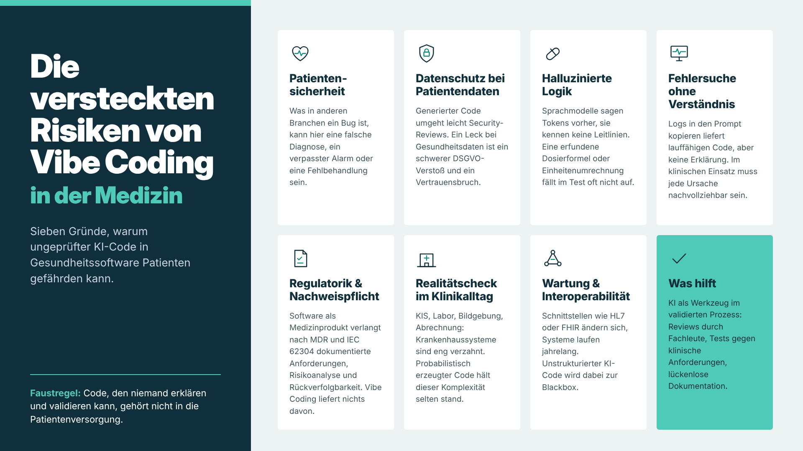

# Vibe Coding in der Medizin – Vom Datensatz zur Web-App

*25.11.2026*

**Ziele**:
1. einen KI-Coding-Agenten einrichten und in natürlicher Sprache steuern,
2. nachvollziehen, *was* der Agent im Hintergrund tut (Code schreiben, ausführen, Fehler beheben),
3. einen klinischen Datensatz explorativ beschreiben und seine Grenzen benennen,
4. mit Prompts ein Vorhersagemodell und eine einfache Web-App erstellen lassen,
5. die Ergebnisse kritisch prüfen – fachlich, methodisch und regulatorisch.

---

## Zeitplan im Überblick

| Zeit | Dauer | Block | Inhalt |
|---|---|---|---|
| 0:00 – 0:10 | 10 min | 0 | Setup: API-Schlüssel, OpenCode-Test |
| 0:10 – 0:20 | 10 min | 1 | Einführung: Was ist Vibe Coding, wie arbeitet ein Agent? |
| 0:20 – 0:45 | 25 min | 2 | Datensatz erkunden (Prompt 1) |
| 0:45 – 0:50 | 5 min | – | Pause |
| 0:50 – 1:15 | 25 min | 3 | Modell bauen (Prompt 2) |
| 1:15 – 1:35 | 20 min | 4 | Web-App bauen (Prompt 3) |
| 1:35 – 1:45 | 10 min | 5 | Reflexion, Grenzen, Fragen |

---

## Part 1: Setup

### 1. Projektordner anlegen

Es wird ein neuer Projektordner angelegt. Dieser ist unabhängig von der bisherigen `.env` und der Analyse. Da die Windows-User nun mit WSL (Ubuntu) arbeiten, muss der neue Ordner im Terminal angelegt werden:
```bash
mkdir heart-project
cd heart-project
```
Unix-User können ihn auch über den Filebrowser anlegen.

### 2. API-Schlüssel in die `auth.json` eintragen

Datei öffnen (`vi`) und über `i` in den Editier-Modus wechseln;
```
cd ~/.local/share/opencode
vi auth.json
```

Der Inhalt sollte wie folgt sein:
```
{
  "llmchat-idm": {
    "type": "api",
    "key": "<PLACEHOLDER>"
  }
}
```
Der Placeholder wird nun ersetzt. Über `Esc` und `:wq` + Enter schreiben und schließen.

**Häufige Fehler:**
- Fehlende Anführungszeichen oder Komma → ungültiges JSON
- Leerzeichen am Anfang/Ende des Schlüssels

### 3. Funktionstest

Nun wird OpenCode einmal getestet:
```
opencode
```

Im OpenCode-Fenster:

1. `/models` eingeben und das bereitgestellte Modell auswählen.
2. Testprompt:

```
Sag in einem Satz, welches Modell du bist, und erstelle eine Datei hello.txt mit dem Inhalt "Setup funktioniert".
```

3. Prüfen: Liegt `hello.txt` im Ordner?

> Ziel 1 erfüllt.

---

## Part 2: Einführung: Was ist Vibe Coding?

### Kernbotschaften

**Vibe Coding** (Begriff von Andrej Karpathy, 2025): Man beschreibt in natürlicher Sprache, *was* man möchte, und lässt eine KI den Code schreiben. Man liest den Code oft nicht Zeile für Zeile, sondern prüft das Ergebnis.

**Wie ein Agent arbeitet – die Schleife:**

```
   Der Prompt
       ↓
 ┌─► Planen: "Was muss ich tun?"
 │     ↓
 │   Handeln: Werkzeug benutzen (Webseite lesen, Datei schreiben, Befehl ausführen)
 │     ↓
 │   Beobachten: Ausgabe/Fehlermeldung lesen
 │     ↓
 └── Fertig? Nein → zurück zum Planen
       ↓ Ja
   Zusammenfassung an User
```


### Drei Regeln für das Arbeiten mit LLMs

1. **Kontext schlägt Kürze.** Je genauer man beschreibt, *was* und *wozu*, desto besser das Ergebnis.
2. **Vertrauen ist gut, Prüfen ist Pflicht.** Mindestens eine Zahl pro Ergebnis selbst nachprüfen.
3. **Iterieren statt neu anfangen.** Wenn etwas nicht passt: nachschärfen („Mach X, aber…“), nicht von vorn.

### OpenCode-Bedienung 

| Aktion | Wie |
|---|---|
| Modell wählen | `/models` |
| Zwischen *Plan*- und *Build*-Modus wechseln | `Tab` (Plan = nur denken/planen, nichts ändern) |
| Dokumentation | `/init` | 
| Neue Sitzung | `/new` |
| Beenden | `/exit` oder `Ctrl+C` |

**Tipp:** Den *Plan*-Modus vor großen Aufgaben nutzen: „Erst planen, dann bauen“ – der Agent schlägt einen Ablauf vor, man prüft ihn, dann `Tab` und ausführen lassen.

---

## Part 3: Den Datensatz kennenlernen

### 1. Medizinischer Hintergrund

- **Quelle:** [Cleveland Clinic Foundation, 1988 (Janosi, Steinbrunn, Pfisterer, Detrano)](https://archive.ics.uci.edu/dataset/45/heart+disease)
- **Population:** 303 Patient:innen, die zur **Koronarangiographie** überwiesen wurden
- **Zielgröße (`num`):** Angiographischer Befund – Stenose > 50 % in mindestens einem großen Gefäß. Werte 0 (keine) bis 4.
- Die Datei hat **keine Kopfzeile** – die Spaltennamen stehen nur auf der Studienseite. Fehlende Werte sind mit `?` markiert.

| Spalte | Bedeutung | Kodierung |
|---|---|---|
| `age` | Alter | Jahre |
| `sex` | Geschlecht | 1 = männlich, 0 = weiblich |
| `cp` | Brustschmerztyp | 1 = typische Angina, 2 = atypische Angina, 3 = nicht-anginöser Schmerz, 4 = asymptomatisch |
| `trestbps` | Ruheblutdruck bei Aufnahme | mmHg |
| `chol` | Serumcholesterin | mg/dl |
| `fbs` | Nüchternblutzucker > 120 mg/dl | 1 = ja, 0 = nein |
| `restecg` | Ruhe-EKG | 0 = normal, 1 = ST-T-Veränderungen, 2 = LVH nach Estes-Kriterien |
| `thalach` | Maximale Herzfrequenz unter Belastung | /min |
| `exang` | Belastungsinduzierte Angina | 1 = ja, 0 = nein |
| `oldpeak` | ST-Senkung unter Belastung vs. Ruhe | mm |
| `slope` | Steigung des ST-Segments im Belastungsmaximum | 1 = aufsteigend, 2 = flach, 3 = absteigend |
| `ca` | Anzahl durchleuchteter Hauptgefäße | 0–3 |
| `thal` | Thallium-Szintigraphie | 3 = normal, 6 = fixierter Defekt, 7 = reversibler Defekt |
| `num` | Diagnose (Zielgröße) | 0 = keine KHK, 1–4 = KHK |


Fragen:
1. Was ist das für ein Patientenkollektiv?
2. Kann ein Modell, welches auf diesen Daten traininert wird, auf der Allgemeinbevölkerung angewendet werden?

### 2. Eigener Prompt

**Aufgabe:** Formuliere selbst einen Prompt, mit dem der Agent den Datensatz herunterlädt und dir einen Überblick verschafft. Überlege: Was möchte ich als Mediziner:in über diesen Datensatz wissen, bevor ich ihm vertraue?

Hilfsfragen:
- Woher soll der Agent wissen, was die Spalten bedeuten?
- Was soll er speichern (Plots, Tabellen, Skript)?
- In welcher Sprache und wie ausführlich soll er antworten?

**Checkpoint-Prompt** (falls jemand nicht weiterkommt):

```
I want to explore this heart disease dataset:
https://archive.ics.uci.edu/ml/machine-learning-databases/heart-disease/processed.cleveland.data

The study page is here: https://archive.ics.uci.edu/dataset/45

Can you download it, figure out what the columns mean, and give me a sense of what's in the data? Missing values, feature distributions, correlations, and how the target breaks down. Save any useful plots.
```

### 3. Was das LLM mit diesem Prompt macht

1. **Webseite abrufen:** Der Agent liest die Studienseite, um die Spaltennamen und Kodierungen zu finden. Ohne den zweiten Link müsste er raten – oder auf Trainingswissen zurückgreifen.
2. **Daten herunterladen:** Meist per `curl` oder direkt in Python (`pandas.read_csv` mit URL).
3. **Abhängigkeiten installieren:** Typisch `pandas`, `matplotlib`, `seaborn`. Manchmal legt er eine virtuelle Umgebung an.
4. **Skript schreiben:** Er erzeugt z. B. `explore.py` mit Code zum Einlesen (`header=None`, `na_values="?"`, Spaltennamen zuweisen).
5. **Ausführen und Fehler beheben:** Wenn z. B. `ca` als Text eingelesen wird, weil dort `?` steht, sieht er die Fehlermeldung und korrigiert sich selbst. **Das ist die Agenten-Schleife in Aktion.**
6. **Plots speichern:** Histogramme, Korrelations-Heatmap, Verteilung der Zielgröße als PNG.
7. **Zusammenfassen:** Eine Beschreibung in Prosa – die *Interpretation* stammt vom Sprachmodell und ist nicht automatisch korrekt.

### 4. Selbst prüfen

**Aufgabe:** Prüfe drei Aussagen des Agenten selbst. Öffne dazu die Rohdatei oder die erzeugten Plots.

Erwartete Ergebnisse zum Abgleich:

| Prüfpunkt | Erwarteter Wert |
|---|---|
| Anzahl Zeilen / Spalten | 303 / 14 |
| Fehlende Werte | `ca`: 4, `thal`: 2 (als `?` kodiert) |
| Verteilung `num` | 0: 164, 1: 55, 2: 36, 3: 35, 4: 13 |
| Binär (keine vs. KHK) | 164 vs. 139 – fast ausgewogen |
| Geschlecht | ca. ⅔ männlich |

**Folgeprompts zum Ausprobieren:**

```
Show me the raw first 5 lines of the file, exactly as they are, before any processing.
```

```
Which column has the strongest association with disease? Explain it to me as you would to a cardiologist.
```

```
Erkläre mir auf Deutsch, warum Patienten mit asymptomatischem Brustschmerz (cp=4) in diesem Datensatz häufiger erkrankt sind.
```

**Lehrmoment (2 min Plenum):** `cp = 4` (asymptomatisch) ist hier der stärkste Risikofaktor beim Brustschmerz – auf den ersten Blick paradox. Erklärung: Wer *ohne* Symptome trotzdem zur Angiographie überwiesen wird, hatte andere starke Gründe (z. B. auffälliges Belastungs-EKG). **Das Modell lernt die Überweisungslogik dieser Klinik, nicht die Biologie.** Frage an die Gruppe: Hat der Agent das von sich aus erkannt?

---


---

## Part 4: Ein Vorhersagemodell bauen

### 1. Minimale Methodik

Nur so viel, wie man braucht, um den Agenten sinnvoll zu steuern:

- **Binäre Klassifikation:** Aus `num` 0–4 wird 0 (gesund) / 1 (KHK).
- **Fehlende Werte imputieren:** z. B. durch Median oder häufigsten Wert ersetzen.
- **Kreuzvalidierung:** Die Daten werden z. B. in 5 Teile geteilt; das Modell wird 5-mal auf 4 Teilen trainiert und auf dem 5. getestet. Das schätzt, wie gut es auf *neuen* Patient:innen funktioniert.
- **Bekannte Kennzahlen:**
  - **Sensitivität** – wie viele Kranke werden erkannt?
  - **Spezifität** – wie viele Gesunde werden korrekt als gesund erkannt?
  - **AUC** – Fläche unter der ROC-Kurve, 0,5 = Münzwurf, 1,0 = perfekt
- **Feature Importance:** Welche Variablen beeinflussen die Vorhersage am stärksten. **Nicht kausal!**

### 2. Eigener Prompt

**Aufgabe:** Schreibe einen Prompt für ein Vorhersagemodell. Überlege bewusst:
- Was ist für eine Diagnostik-Anwendung schlimmer – ein übersehener Kranker oder ein falscher Alarm? Welche Kennzahl willst du also sehen?
- Soll das Modell interpretierbar sein?

**Checkpoint-Prompt:**

```
Now let's build a model to predict heart disease. Treat it as binary —
target 0 means no disease, anything above 0 means disease present.

Handle the missing values, compare a couple of models with cross-validation,
and save the best one. Show me feature importance so I know what's driving
predictions.
```

### 3. Was das LLM mit diesem Prompt macht

1. **Kontext nutzen:** Der Agent erinnert sich an die Sitzung – er weiß, wo die Daten liegen und wie die Spalten heißen. (Deshalb in derselben Sitzung bleiben!)
2. **Zielvariable binarisieren:** `target = (num > 0).astype(int)`.
3. **Pipeline bauen:** Typischerweise mit `scikit-learn`: Imputation → ggf. Skalierung / One-Hot-Encoding der kategorialen Variablen (`cp`, `restecg`, `slope`, `thal`) → Modell. Eine Pipeline verhindert, dass Informationen aus den Testdaten ins Training „durchsickern“ (**Data Leakage**).
4. **Modelle vergleichen:** Oft logistische Regression, Random Forest, Gradient Boosting, ggf. SVM.
5. **Kreuzvalidierung:** z. B. 5-fach stratifiziert, Ausgabe von Accuracy und/oder ROC-AUC mit Standardabweichung.
6. **Bestes Modell speichern:** Meist als `model.pkl` oder `model.joblib` – diese Datei braucht später die Web-App.
7. **Feature Importance:** Koeffizienten (logistische Regression) oder Impurity-/Permutation-Importance (Baummodelle), als Plot gespeichert.

**Typische Ergebnisse (zum Abgleich):** ROC-AUC etwa 0,88–0,92, Accuracy etwa 0,80–0,85. Wichtigste Variablen meist `thal`, `ca`, `cp`, `oldpeak`, `thalach`, `exang`. Auf diesem kleinen Datensatz schlägt die logistische Regression oft die komplexen Modelle.

### 4. Kritisch nachfragen

Mindestens zwei dieser Folgeprompts ausprobieren:

```
Report sensitivity and specificity for the best model, and show me a ROC curve and a confusion matrix.
```

```
Was the imputation done inside the cross-validation, or before it? Show me the relevant code and explain whether there is any data leakage.
```

```
How well calibrated is the model? If it says 70% risk, are about 70% of those patients really sick? Show a calibration plot.
```

```
Wir wollen keine Kranken übersehen. Wähle einen Schwellenwert mit Sensitivität ≥ 90 % und zeige, was das für die Spezifität bedeutet.
```

**Lehrmoment (2 min Plenum):**
- 303 Patient:innen sind *sehr wenig*. Die Ergebnisse schwanken stark zwischen den Folds.
- Kein externer Testdatensatz → wir wissen nicht, ob das Modell in einer anderen Klinik funktioniert. (Der UCI-Datensatz enthält übrigens auch Daten aus Ungarn, der Schweiz und Long Beach – eine ideale externe Validierung als Hausaufgabe.)
- Feature Importance ≠ Kausalität: `ca` ist wichtig, weil es eng mit dem Ergebnis der Angiographie zusammenhängt – nicht, weil man daran therapeutisch drehen könnte.

---

## Part 5: Eine Web-App bauen

### 1. Einführung

- **Flask** ist ein kleines Python-Framework, mit dem man eine Webseite lokal auf dem eigenen Rechner bereitstellen kann.
- Die App lädt das gespeicherte Modell, nimmt Eingaben über ein Formular entgegen und gibt eine Wahrscheinlichkeit zurück.
- Sie läuft nur lokal (`http://127.0.0.1:5000`), nicht im Internet.

### 2. Prompt ausführen 
Entweder direkt so ausführen oder anpassen:
**Checkpoint-Prompt:**

```
Now wrap that model in a simple Flask web app. I want a clean page where someone can enter a patient's clinical values and get a heart disease risk prediction. Make it look professional, add a disclaimer that it's not for clinical use.
```

### 3. Was das LLM mit diesem Prompt macht

1. **Flask installieren** (`pip install flask`).
2. **Projektstruktur anlegen:** typischerweise `app.py`, `templates/index.html`, ggf. `static/style.css`.
3. **Modell laden:** `joblib.load("model.joblib")` beim Start der App.
4. **Formular generieren:** Ein Eingabefeld pro Variable. Gute Agenten machen aus kodierten Variablen Auswahlmenüs (z. B. „typische Angina“ statt „1“) – das hängt davon ab, ob er den Kontext aus Block 2 nutzt.
5. **Vorhersage-Route:** Formular-Werte → DataFrame mit *exakt* denselben Spaltennamen wie im Training → `predict_proba` → Anzeige als Prozent.
6. **Design:** HTML/CSS, oft mit einem CSS-Framework.
7. **Disclaimer einbauen** und die App starten (`python app.py`).

**Typische Fehler, die der Agent oft selbst behebt:** Spaltenreihenfolge stimmt nicht, Port 5000 ist belegt (auf macOS durch AirPlay → anderer Port), Datentypen aus dem Formular sind Text statt Zahl.

App im Browser öffnen: `http://127.0.0.1:5000`

### 4. Testen und verbessern

-- **Flowdiagramm der Architektur/darstellen** --

**Aufgabe 1 – Plausibilitätstest:** Gib zwei Fallvignetten ein und prüfe, ob das Ergebnis klinisch plausibel ist:

| | Patient A | Patient B |
|---|---|---|
| Alter | 45 | 63 |
| Geschlecht | weiblich | männlich |
| Brustschmerz | nicht-anginös | asymptomatisch |
| Ruhe-RR | 120 | 145 |
| Cholesterin | 200 | 280 |
| Max. HF | 175 | 120 |
| Belastungsangina | nein | ja |
| ST-Senkung | 0,0 | 2,5 |
| ST-Steigung | aufsteigend | flach |
| Gefäße (ca) | 0 | 2 |
| Thallium | normal | reversibler Defekt |

Erwartung: A niedriges, B hohes Risiko.

**Aufgabe 2 – Unsinnige Eingaben:** Gib ein Alter von 250 oder einen Blutdruck von 0 ein. Was passiert?

**Folgeprompts zur Verbesserung (eine auswählen):**

```
Add input validation with physiologically plausible ranges, and show a clear error message in German if a value is out of range.
```

```
Übersetze die gesamte Oberfläche ins Deutsche und erkläre bei jedem Feld in einem kurzen Hilfetext, was gemeint ist.
```

```
Below the prediction, show which 3 features pushed this specific patient's risk up or down the most.
```

```
Show the prediction as a risk category (low / intermediate / high) with the cut-offs explained, in addition to the percentage.
```

---

## Part 6: Reflexion und Abschluss

### Leitfragen für die Diskussion

1. **Wie viel Code hast du geschrieben?** Wie viel davon hast du gelesen? Wie sicher bist du, dass er korrekt ist?
2. **Wo hat der Agent Fehler gemacht oder etwas Fragwürdiges behauptet?**
3. **Würden Sie diese App bei einem echten Patienten einsetzen?** Warum nicht?

### Kernbotschaften zum Mitnehmen

- **Vibe Coding senkt die Einstiegshürde dramatisch.** In 90 Minuten von null zu einer funktionierenden Prototyp-App – ohne Programmierkenntnisse.
- **Ein Prototyp ist kein Medizinprodukt.** Software, die eine Diagnose- oder Therapieentscheidung unterstützt, fällt in der EU unter die **Medizinprodukteverordnung (MDR)** und ist in der Regel zulassungspflichtig; KI-Systeme in diesem Bereich gelten zudem nach dem **EU AI Act** als Hochrisiko-Systeme.
- **Datenschutz:** Wir haben öffentliche, anonymisierte Daten verwendet. Echte Patientendaten dürfen nicht ohne Weiteres an ein externes LLM geschickt werden (DSGVO, Schweigepflicht).
- **Die eigentliche ärztliche Kompetenz** liegt im Fragen, Prüfen und Einordnen: Population, Bias, Kennzahlen, klinische Plausibilität. Genau das kann der Agent Ihnen nicht abnehmen.




### Wofür Vibe Coding im Studium und in der Forschung sinnvoll ist

- Schnelle Datenexploration für Doktorarbeiten (mit Prüfung durch Statistik!)
- Abbildungen und Tabellen für Poster und Paper
- Kleine Hilfswerkzeuge (Rechner, Lernkarten, Literatur-Tools)
- Prototypen, um mit Informatiker:innen über eine Idee zu sprechen

### Hausaufgabe (optional)

```
The UCI heart disease collection also contains data from Hungary, Switzerland and Long Beach (processed.hungarian.data, processed.switzerland.data, processed.va.data in the same folder). Test our saved model on these datasets without retraining and compare the performance to the Cleveland cross-validation results. Explain any differences.
```

→ Externe Validierung: Wie gut übertragt sich das Modell auf andere Kliniken? 
(Spoiler: deutlich schlechter – und viele fehlende Werte.)

---

## Anhang A – Troubleshooting

| Problem | Lösung |
|---|---|
| OpenCode meldet Authentifizierungsfehler | JSON in `auth.json` prüfen (z. B. mit einem Online-JSON-Validator **ohne** echten Schlüssel), Provider-ID prüfen, alternativ `/connect` |
| Modell nicht auswählbar | `/models` – richtigen Provider wählen |
| `python` nicht gefunden | `python3` verwenden; Agent bitten: „Use python3 and a virtual environment“ |
| Pakete lassen sich nicht installieren | Agent bitten, eine virtuelle Umgebung anzulegen (`python3 -m venv .venv`) |
| Download der Daten schlägt fehl (Netzwerk/Firewall) | Lehrperson stellt `processed.cleveland.data` lokal bereit; Prompt anpassen: „The data is in ./processed.cleveland.data“ |
| Agent hängt in einer Fehlerschleife | Unterbrechen (`Esc`), Problem in eigenen Worten beschreiben, oder neue Sitzung mit kurzer Zusammenfassung des Stands |
| Web-App startet nicht, Port belegt | Agent bitten: „Run the app on port 5050“ |
| Seite lädt nicht | Terminal prüfen – läuft `app.py` noch? Richtige Adresse `http://127.0.0.1:PORT`? |

## Anhang B – Prompting-Spickzettel

Ein guter Prompt enthält:

1. **Ziel:** Was soll am Ende herauskommen? („eine Web-App“, „ein Plot“, „eine Tabelle“)
2. **Kontext:** Daten, Quelle, medizinischer Hintergrund
3. **Vorgaben:** Methode, Kennzahlen, Sprache, Design
4. **Prüfbarkeit:** „Zeig mir…“, „Erkläre…“, „Speichere…“
5. **Grenzen:** Was soll der Agent *nicht* tun?

Gute Formulierungen zum Nachschärfen:
- „Bevor du etwas änderst, erkläre mir deinen Plan.“
- „Zeig mir den Code, der X berechnet, und erkläre ihn Zeile für Zeile.“
- „Wie sicher bist du dir? Was könnte an diesem Ergebnis falsch sein?“
- „Erkläre es so, dass es eine Kardiologin ohne Statistikkenntnisse versteht.“
